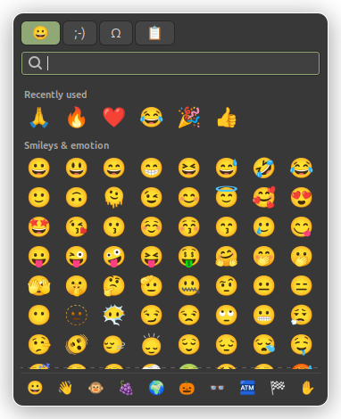
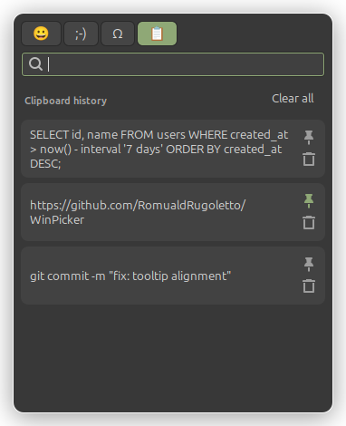

# WinPicker

Windows 11's `Win+.` emoji panel and `Win+V` clipboard history, for Linux Mint (Cinnamon, X11).

<p>
  
  
</p>

| Shortcut | Action |
|---|---|
| `Super+.` or `Super+;` | Opens the picker on the **Emoji** tab |
| `Super+V` | Opens the same picker on the **Clipboard history** tab |
| Same shortcut again / `Esc` | Closes it |

Tabs: Emoji · Kaomoji · Symbols · Clipboard history.
The chosen item is pasted straight into the window the shortcut was pressed from.

## Requirements

- Linux Mint (Cinnamon) or any X11 session; **Wayland is not supported**.
- Python 3.10+, GTK 3 with PyGObject, python3-xlib, IBus emoji dictionaries, gettext:
  all preinstalled on Linux Mint. On other distributions (Debian/Ubuntu names):

  ```bash
  sudo apt install python3-gi gir1.2-gtk-3.0 gir1.2-ibus-1.0 ibus-data python3-xlib gettext fonts-noto-color-emoji
  ```

The keyboard shortcuts are registered for Cinnamon. On another desktop, bind
`bin/winpicker emoji` and `bin/winpicker clipboard` to the keys of your choice.

## Installation

```bash
git clone https://github.com/RomualdRugoletto/WinPicker.git
cd WinPicker
./install.sh      # per-user, no sudo
```

`install.sh` compiles the translations, adds `~/.local/bin/winpicker`, an autostart entry and
the Cinnamon shortcuts, then starts the daemon. Since IBus already grabs `Super+.` and `Super+;`
for its own emoji picker, its shortcut is disabled (and restored by `uninstall.sh`).

```bash
./uninstall.sh            # removes everything install.sh set up
./uninstall.sh --purge    # also deletes pinned and recently used items
```

## Usage

- Just type to search. Emoji match names in your language and in English, accents optional
  (`eclair`, `coeur`, `thumbs up`).
- `Enter` inserts the first result. `↓` then the arrow keys to navigate, `Enter`/`Space` to insert.
- `Ctrl+Tab` / `Ctrl+Shift+Tab`: next / previous tab.
- Clipboard history: `Delete` removes the selected item; the pin icon keeps an item.

## Behavior

Modeled on Windows 11:

- The history keeps the last 25 items (text and images), deduplicated; copying an item again moves it to the top.
- Only **pinned** items survive a restart. They are stored in `~/.local/share/winpicker/pinned.json` (mode 600).
- Inserting an emoji or symbol does not end up in the history, and the previous clipboard content is restored.
- Copies flagged by password managers (`x-kde-passwordManagerHint`, used by KeePassXC) are not recorded.
- In terminals, pasting uses `Ctrl+Shift+V` (see `TERMINALS` in `winpicker/x11.py`).

## How it works

A small GTK daemon starts with the session, watches the clipboard and keeps the window ready.
The keyboard shortcuts run `bin/winpicker`, which calls the daemon over D-Bus. When an item is
picked, the daemon puts it on the clipboard, gives focus back to the previous window and
simulates `Ctrl+V` through the X11 XTEST extension.

```
bin/winpicker                    launcher run by the shortcuts (D-Bus call, or starts the daemon)
winpicker/app.py                 single-instance Gtk.Application: D-Bus actions, paste logic
winpicker/window.py              floating window: tabs, search, keyboard handling
winpicker/tabs.py                emoji/kaomoji/symbol grids and clipboard list
winpicker/clipboard_history.py   clipboard monitoring, pinning, persistence
winpicker/emoji_data.py          emoji data from the IBus dictionaries (/usr/share/ibus/dicts)
winpicker/x11.py                 active window and simulated Ctrl+V (XTEST)
winpicker/i18n.py                gettext setup and system language detection
po/                              translations
```

To run it from the source tree without installing: `bin/winpicker daemon`, then `bin/winpicker emoji`.

## Translating

The interface follows the system language (`LANGUAGE` / `LANG`); English is the fallback.

```bash
po/update.sh                                   # refresh po/winpicker.pot and existing po/*.po
msginit -i po/winpicker.pot -o po/de.po -l de  # start a new language
po/compile.sh                                  # build locale/ (also done by install.sh)
```

Emoji names come from IBus, which already ships many languages.

## Known limitations

- X11 only.
- The window opens near the mouse pointer: the text caret position isn't easily available on X11.
- Keys typed before the window has focus (within ~50 ms of the shortcut) go to the previous window.

## License

[GPL-3.0-or-later](LICENSE). Not affiliated with Microsoft; "Windows" is only used to describe the
behavior being reproduced.
